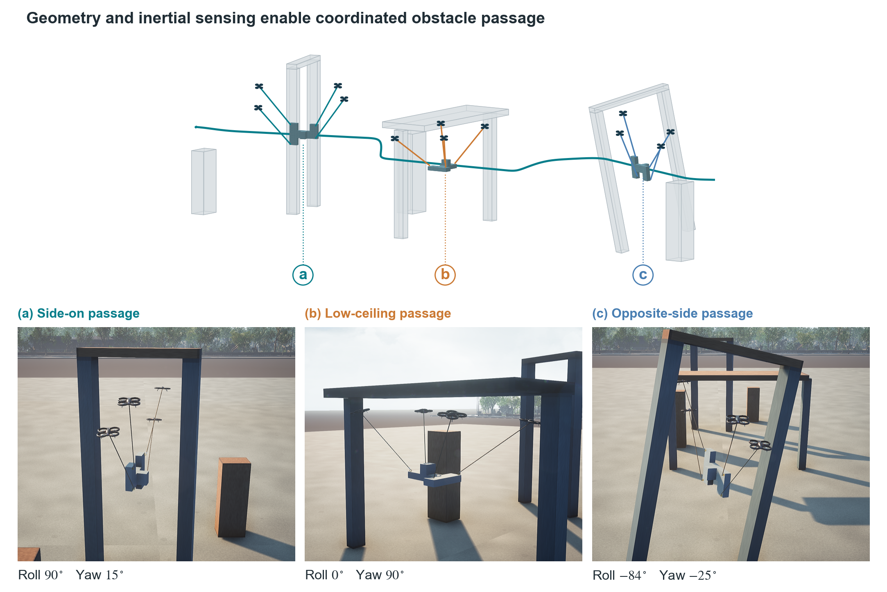

# ForestSling

Vision- and tension-informed inertial identification and formation reconfiguration
for cooperative aerial transport through known obstacles.



The model includes three or four free quadrotors, a rigid nonconvex payload,
unilateral compliant cables, first-order motor dynamics, virtual RGB-D pose
registration, integral inertial identification and conic force planning.
The payload reference family and obstacle map are supplied; force allocation,
support endpoint geometry and finite timing/lowering choices are computed.

The manuscript snapshot is fixed at [v0.2.0](https://github.com/shepherd-p/ForestSling/tree/v0.2.0).
The [English manuscript](paper/ForestSling_AST_Manuscript.pdf) includes the
second-round comparisons and experiments. The principal base-task tracking
benefit is attributed to center-of-mass correction; complete-inertia accuracy
and held-out prediction are evaluated separately.

## Installation

Use Python 3.10 or newer in a clean virtual environment:

```sh
python -m pip install -r requirements.txt
```

The pinned numerical packages match the archived experiment environment. A fresh
Python 3.12 installation also passed all 12 tests and completed an RGB-D
closed-loop transport run. The archived experiments used Python 3.10 and OpenCV
5.0.0; the portability run used OpenCV 4.14.0.94. Wall-clock image arrivals can
vary between executions.

MuJoCo image capture requires a working OpenGL context. Numerical analysis and
archived figure regeneration do not require Unreal Engine.

## Recompute the archived results

```sh
python paper/tools/recompute_results.py
python paper/tools/build_figures.py
python paper/tools/review_analysis.py
python paper/tools/review_replay.py
python paper/tools/review_aggregate.py
python paper/tools/round2_summary.py
python paper/tools/round2_tables_text.py
python paper/tools/round2_trial_tables.py
python paper/tools/check_round2_evidence.py
python -m pytest tests -q
```

`runs/` contains original dynamic records, sensor records needed by the
identification analysis and the revision experiments. Every task has a
protocol and evaluator mass properties. `paper/supplementary/review_20261027/`
contains the complete inertial audit, held-out prediction, declared
observation-space sensitivity and independent replay results. Reanalysis of
archived records is distinct from new closed-loop executions.

`paper/supplementary/round2_20261027/` adds measured impulse residuals,
fixed-reference parameter-to-force/endpoint comparisons, stagewise constrained
wrench allocation, support-free PSD and raw least-squares identification,
residual-scaling and smoothing sensitivity, fine geometric replay, and the
N/A/B experiment identity index. The isolated regeneration check matches
all nine figure PNGs and seven generated table fragments.

The second round retains all 30 initial attempts. The process-isolated image
pipeline completes and passes 20/20 executions of the same twenty seeds used
in the original 16/20 cohort, with the unchanged 0.35 s image-age gate. Both
cohorts remain archived. Four identification-baseline attempts include the
original nonphysical raw-OLS rejection and its exception log. Of six declared
closed-loop perturbation attempts, five complete transport and three pass
every gate. These are fixed-task sensor repetitions and representative
mismatch conditions, rather than a cross-object robustness estimate.

## Run a new image-based closed-loop experiment

```sh
python research/vision_tension_20261025/vision_closed_loop.py --out runs/local_four_irregular --beam --count 4 --shape irregular --method estimated --duration 20 --physics-dt .0005
```

For the large-angle forked course, add `--course --corner-mounts --pose-mode
large --shape forked --duration 125`. Each output directory must be new.
The controller runs at 50 Hz and the virtual RGB-D worker requests images at
10 Hz. Initial whole-segment planning runs while the system remains in hover.

The frozen five-arm ablation and 20 independent sensor-seed repetitions are
specified by `research/vision_tension_20261025/review_batch.py`. That script
retains failed attempts; it does not silently drop unsuccessful trials.

For wall-clock experiments, run the simulator without concurrent heavy analysis.
Image-age gate failures and explicitly labeled retries remain separate records.
The original first-attempt seed cohort is never replaced by retry outcomes.

For the process-isolated image worker and its timestamp decomposition, run:

```sh
python research/vision_tension_20261025/round2_vision_closed_loop.py --out runs/local_process_box --beam --count 4 --shape rectangular --method estimated --duration 20 --physics-dt .0005 --sensor-seed 27000
```

`round2_batch.py` specifies the frozen 30-attempt protocol. Existing archive
directories are preserved; use a new output directory for an individual rerun.
Author-run clean-environment tests and anonymous download checks document
portability and archive integrity; they are not third-party replication.

## Source and visual assets

First-party code is licensed under MIT. NumPy, SciPy, Matplotlib, Pillow,
OpenCV, Clarabel and MuJoCo remain subject to their respective upstream
licenses and are installed as dependencies rather than vendored here.
The original Unreal CityPark project and proprietary scene/vehicle assets
are excluded. Camera figures are rendered outputs of recorded dynamic
states, not a second physical execution. The numerical model and its RGB-D
sensor do not depend on CityPark assets.

## Citation

The associated manuscript targets Aerospace Science and Technology. No
publication DOI is assigned to this repository snapshot. Author and funding
information appears in `paper/manuscript/author_information.tex`.
